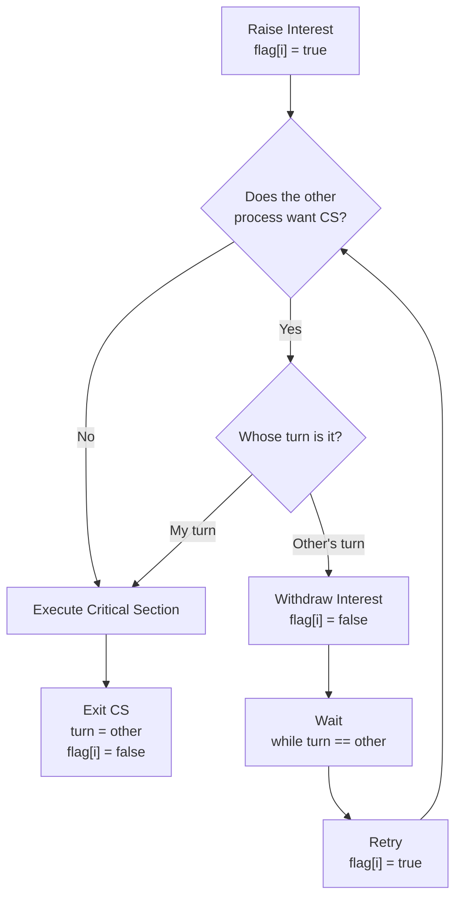

## 1. Dekker vs Peterson
Dekker's algorithm and Peterson's algorithm solve the same mutual exclusion problem for two processes using flags and a turn variable. The difference is in how conflict is handled.
Peterson's algorithm: The process stays interested and uses turn to give priority if both processes want to enter.

Dekker's algorithm: The process may lower its own flag, wait, and then raise it again. 

Peterson's algorithm is more compact and symmetric. Dekker's algorithm handles conflict through multiple steps: withdraw, wait, and retry.