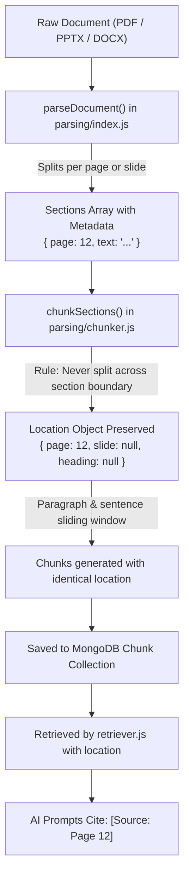

# Quesions

1. how does mongodb mantain acid properties?how is that different from sql databses 
2. How do test parsers work - unpfd,pdf_parse,mamoth--here i am asking about how do they internally work that is explain me the technology 
3. explain these crypto library functions createhash, update, digest
4. how does vector embedding work --i mean explain the technology at its core
5. in receiver.js i got a warning form vs code saing .objectID is depriciated will that work or wil it be fine(answer only dont change code)
6. how are you preserving source citation meta data while chunking?

# Answers

### 1. How MongoDB Maintains ACID Properties & How It Differs from SQL Databases

#### **How MongoDB Maintains ACID**
To truly understand how MongoDB provides **ACID guarantees**, we need to look under the hood at its storage engine: **WiredTiger** (which MongoDB uses by default) and its distributed consensus mechanism (**Replica Sets & Oplog**).

In a traditional SQL database (like PostgreSQL or MySQL InnoDB), ACID was designed from day one around a single machine with normalized tables, row locks, undo logs, and redo logs. MongoDB, by contrast, was designed as a distributed, document-oriented system. 

Here is the exact internal mechanics of how MongoDB establishes each of the four ACID properties.

---

```
                       MONGODB ARCHITECTURAL FLOW (WIREDTIGER)
                       
  Client Write Request
          │
          ▼
   ┌──────────────┐      Snapshot Read / Version Checks (MVCC)
   │ Query Router │ ────────────────────────────────────────────────┐
   └──────┬───────┘                                                 │
          ▼                                                         ▼
   ┌──────────────┐  In-Memory Write  ┌─────────────────────────────────────────────────┐
   │  WiredTiger  │ ────────────────► │  WiredTiger Cache (Dirty Pages & Version Chain)  │
   │    Engine    │                   └───────────────────────┬─────────────────────────┘
   └──────┬───────┘                                           │
          │                                                   │ Checkpoint every 60s
          ├─────────────────────────┐                         ▼
          ▼                         ▼                  ┌──────────────┐
   ┌──────────────┐          ┌──────────────┐          │ Data Files   │
   │ In-Memory    │          │ Disk Journal │          │ (.wt files)  │
   │ Oplog Buffer │          │ (WAL / fsync)│          └──────────────┘
   └──────┬───────┘          └──────────────┘
          ▼
   Secondary Nodes
   (Replication / Majority ACK)
```

---

### 1. ATOMICITY: "All-or-Nothing" Execution

Atomicity guarantees that a series of modifications either completely succeed or leave the database completely untouched.

#### A. Single-Document Atomicity (Native / Default)
In MongoDB, a single document can contain deeply nested arrays, embedded objects, and dozens of fields. 
- **The Internal Mechanism:**
  When you execute an update (e.g. `updateOne` with `$set`, `$push`, `$inc`):
  1. WiredTiger acquires an internal **latch** (a lightweight in-memory lock) on that specific document’s in-memory memory structure.
  2. The update is applied to the document in the **WiredTiger Cache** as a single atomic unit.
  3. The change is written as a single record into the **journal** buffer.
  4. The latch is released.
- **Why SQL needed transactions for this:** In SQL, normalized data is split across multiple tables (e.g. `User`, `UserAddresses`, `UserRoles`). Updating a user profile requires multiple `UPDATE` and `INSERT` statements across 3 tables—mandating a multi-table transaction block (`BEGIN ... COMMIT`). In Mongo, because the address and roles are embedded inside the `User` document, single-document atomicity solves ~90% of business update scenarios without transaction overhead.

#### B. Multi-Document Transactions (MongoDB 4.0+ Replica Sets, 4.2+ Sharded)
When you update multiple documents across different collections in a transaction:

```javascript
const session = client.startSession();
session.startTransaction();
try {
  await Material.updateOne({ _id: matId }, { status: 'ready' }, { session });
  await Chunk.insertMany(chunks, { session });
  await session.commitTransaction();
} catch (err) {
  await session.abortTransaction();
}
```

- **Internally:**
  1. **Private Transaction Buffer:** When `startTransaction()` is called, WiredTiger allocates a **private memory buffer** tied to that `session`. 
  2. **Uncommitted Writes are Staged:** Any updates or inserts performed within the session do not alter the main global data pages visible to other threads. They are staged in WiredTiger's private transaction memory.
  3. **Abort (`abortTransaction`):** If an error occurs, the rollback is almost instantaneous: MongoDB simply discards the in-memory transaction buffer. No disk rollbacks or undo scripts are needed because the uncommitted modifications were never exposed to other sessions or finalized on disk.
  4. **Commit (`commitTransaction`):**
     - **On a Replica Set:** MongoDB packages all the operations from the transaction into a **single, composite Oplog entry** called `applyOps`. This guarantees that when secondary nodes replicate the transaction, they apply it as an indivisible unit.
     - **On a Sharded Cluster (Two-Phase Commit / 2PC):** If the transaction spans multiple shards, MongoDB uses a **Two-Phase Commit** protocol. One shard acts as the *Coordinator*. In Phase 1 (*Prepare*), all participant shards write their changes to their journals in a "prepared" state. In Phase 2 (*Commit*), the coordinator instructs all shards to commit simultaneously.

---

### 2. CONSISTENCY: Valid State Transitions

Consistency ensures that a transaction takes the database from one valid state to another, maintaining all explicit and implicit rules.

#### A. Internal Mechanisms in MongoDB
1. **Document Validation Rules (`$jsonSchema`):**
   MongoDB validates schema constraints at the engine level before committing a write to the cache. If a write violates a required field or data type, the operation fails before altering state.
2. **Unique Indexes:**
   WiredTiger maintains index B-Trees. When a transaction inserts a document, WiredTiger inserts a key into the index B-Tree. If another transaction has committed that key, it raises a duplicate key error (`E11000`).
3. **Snapshot Consistency Across Collections:**
   When a transaction begins with `readConcern: "snapshot"`, MongoDB locks in a **Global Cluster Timestamp** (from its Hybrid Logical Clock). All queries inside that transaction read from that exact timestamp across all collections. You will never see partial writes from another transaction.
4. **Majority Write Concern (`w: "majority"`):**
   In a distributed database, consistency can be broken if a primary node crashes and an uncommitted write is lost during an election (causing a "rollback"). By using `w: "majority"`, MongoDB does not report success until a majority of replica nodes acknowledge the write, ensuring the state transition is irreversible.

#### How it differs from SQL:
- SQL databases enforce **declarative relational integrity** at the database engine level: Foreign Keys (`REFERENCES table(id) ON DELETE CASCADE`), Table Triggers, and `CHECK` constraints.
- In MongoDB, foreign keys (e.g. `ref: 'Workspace'` in `Chunk.js`) are logical references validated by application libraries (like Mongoose) rather than by the database engine itself.

---

### 3. ISOLATION: Multi-Version Concurrency Control (MVCC)

Isolation ensures that concurrent transactions do not interfere with each other. MongoDB uses **MVCC (Multi-Version Concurrency Control)** inside the WiredTiger engine to provide **Snapshot Isolation**.

```
DOCUMENT VERSION CHAIN IN WIREDTIGER MEMORY:

Document _id: "chunk_101"
┌─────────────────────────────────────────────────────────────┐
│  Version 3 (Timestamp: T30) - Uncommitted (Tx 99)           │ ───► Visible ONLY to Tx 99
├─────────────────────────────────────────────────────────────┤
│  Version 2 (Timestamp: T20) - Committed                     │ ───► Visible to transactions
│  text: "Updated chunk text..."                              │      starting at T20 to T29
├─────────────────────────────────────────────────────────────┤
│  Version 1 (Timestamp: T10) - Committed                     │ ───► Visible to transactions
│  text: "Original chunk text..."                             │      starting at T10 to T19
└─────────────────────────────────────────────────────────────┘
```

##### A. How MVCC Works Internally
1. **No In-Place Overwrites:**
   When a document is modified, WiredTiger does not overwrite the existing bytes in memory. Instead, it appends a new **version record** to that document's in-memory version chain, tagged with:
   - A Transaction ID
   - A Commit Timestamp ($T$)
2. **Read Timestamps:**
   When Transaction $B$ starts at timestamp $T_{25}$, it is assigned a **Read Timestamp** of $T_{25}$.
   When Transaction $B$ reads a document, WiredTiger walks down the document’s version chain:
   - It ignores Version 3 because it was written at $T_{30}$ ($> T_{25}$) or is uncommitted.
   - It selects Version 2 because $T_{20} \le T_{25}$ and is committed.
   - **Result:** Transaction $B$ never reads uncommitted ("dirty") data and never blocks writers. Readers never block writers, and writers never block readers.
3. **Write-Write Conflict Resolution (Optimistic Concurrency):**
   What happens if Transaction $A$ and Transaction $B$ try to update the exact same document at the same time?
   - WiredTiger uses **first-committer-wins**:
   - Transaction $A$ updates the document first.
   - When Transaction $B$ attempts to modify the same document, WiredTiger detects that the document has been modified since Transaction $B$'s snapshot timestamp.
   - Instead of deadlocking or waiting indefinitely, WiredTiger aborts Transaction $B$ immediately with a `WriteConflict` error. The MongoDB driver can catch this error and automatically retry the transaction.

#### How it differs from SQL:
- Many traditional SQL systems (e.g., MySQL InnoDB) rely heavily on **pessimistic row locking** and **gap locking**:
  - `SELECT ... FOR UPDATE` locks rows explicitly.
  - "Next-Key Locks" lock the gaps between index records to prevent Phantom Reads.
- MongoDB multi-document transactions avoid gap locks entirely; they operate purely under **Snapshot Isolation**, using timestamps and version chains.


To understand this, let’s break down the problem it solves, what the words actually mean, and what happens behind the scenes.

---

#### 1. The Problem: The "Frankenstein View" Without a Snapshot

Imagine your AlgoPrep app has two collections: `Materials` and `Workspaces`.

Suppose a student uploads a new document, and your system updates both collections at the exact same time:
1. Deduct 1 upload credit in `Workspaces` (from 5 credits down to 4).
2. Insert 1 new record into `Materials`.

Now imagine another request (e.g., an analytics or dashboard query) runs without a snapshot:
* At **2:00:01 PM**, it queries `Workspaces` $\rightarrow$ reads **5 credits left** *(the old data)*.
* At **2:00:02 PM**, the background worker updates `Workspaces` and inserts the new `Material`.
* At **2:00:03 PM**, the analytics query moves on to query `Materials` $\rightarrow$ reads **the newly inserted material** *(the new data)*.

**Result:** Your query saw a world where the new material exists, but the user still has 5 credits. It combined "past" data from one collection with "future" data from another collection. That is an **inconsistent state** (or seeing partial writes).

---

#### 2. What is a "Snapshot"? (The High-Speed Camera Analogy)

A **Snapshot** is like taking a photographic snapshot of the entire database across all collections at one exact millisecond.

* When you start a transaction with `readConcern: "snapshot"`, MongoDB says:
  > *"Freeze! For the entire duration of your transaction, no matter how many collections you query or how long your queries take, I will show you the database exactly as it looked at this precise snapshot moment."*
* Even if other users insert, update, or delete thousands of documents across `Workspaces`, `Materials`, and `Chunks` while your transaction is running, **your transaction will not see any of those changes**. Everything you see is mutually consistent.

---

#### 3. What is the "Global Cluster Timestamp" and "Hybrid Logical Clock"?

In a distributed database (where you have a Primary server and multiple Secondary servers):
* **Computer clocks cannot be trusted:** Physical hardware clocks on different servers drift by several milliseconds (clock skew). If Server A says "2:00:00.100" and Server B says "2:00:00.095", you cannot reliably order events using physical time alone.
* **The Solution — Hybrid Logical Clock (HLC):**
  MongoDB uses a Hybrid Logical Clock. It combines the physical time (from the machine clock) with a monotonic logical sequence counter:
  $$\text{ClusterTime} = (\text{Physical Time}, \text{Sequence Counter})$$
* **Why it matters:** 
  Every single server in the MongoDB cluster coordinates with this clock. When you start your transaction, MongoDB tags your session with a single scalar value, say:
  $$T = 1730680000.4$$
  This is your **Global Cluster Timestamp**.

---

#### 4. How WiredTiger Uses It Under the Hood (MVCC Version Chains)

Remember from earlier that WiredTiger never overwrites documents in-place; it keeps a **version history** of every document:

```
Document in "Materials":
  - Version 2 (Committed at T = 1730680005)  <-- Written AFTER your snapshot
  - Version 1 (Committed at T = 1730680000.1) <-- Written BEFORE your snapshot
```

When your transaction queries the database:
1. You query `Materials`: WiredTiger looks at the document versions. It sees Version 2 was created at $T=1730680005$, which is *after* your snapshot timestamp ($T=1730680000.4$). WiredTiger **ignores Version 2 and hands you Version 1**.
2. Five seconds later, your transaction queries `Chunks`: WiredTiger repeats the same logic—it only returns chunk versions committed at or before your exact snapshot timestamp $T=1730680000.4$.

---

#### Summary in Plain English

When the plan says:
> *"Locks in a Global Cluster Timestamp... all queries read from that exact timestamp across all collections... you will never see partial writes."*

It means:
1. **"Locks in a timestamp"** $\rightarrow$ It picks one specific tick of the cluster's global master clock when your transaction begins.
2. **"Across all collections"** $\rightarrow$ Whether you query `User`, `Workspace`, `Material`, or `Chunk`, every query is pinned to that exact same tick of the clock.
3. **"Never see partial writes"** $\rightarrow$ If another process is halfway through inserting 100 chunks and updating a material's status, you will either see **none** of their changes (if they haven't committed yet) or you will see **all** of them (if they committed before your snapshot timestamp). You will never catch them in the middle.

To understand what **"readers never block writers"** means, let's look at how databases used to handle concurrency (using locks) versus how modern engines like **WiredTiger (MongoDB)** handle it (using MVCC).

---

### 1. The Old Way: Locking (Where Readers DO Block Writers)

In traditional or older database architectures, databases used **read/write locks**:
* When someone wants to **read** a document/row, they grab a **Shared Lock (Read Lock)**.
* When someone wants to **write/update** that document/row, they must grab an **Exclusive Lock (Write Lock)**.

**The Rule:** You cannot have a Write Lock while anyone holds a Read Lock.

```
THE LOCKING PROBLEM:

Reader (Student running a big search query):
  "I am reading these 10,000 chunks..." ───► [Holds Read Lock for 5 seconds]
                                                      │
                                                      ▼
Writer (Background Ingestion Worker):                 │
  "I want to update chunk #42!"          ───► [BLOCKED! Must wait 5 seconds] ⏳
```

In this old model, the reader literally **halts (blocks)** the writer. If 50 students are reading the database, a background worker trying to save new data gets stuck in a queue waiting for them to finish.

---

### 2. The Modern MVCC Way: "Never Blocks Writers"

Modern engines like WiredTiger solve this with **MVCC (Multi-Version Concurrency Control)**. 

Instead of locking data, MongoDB creates **multiple timestamped versions** of the document:

```
HOW WIREDTIGER HANDLES THIS (NO BLOCKING):

Reader (Student running search query at Timestamp T10):
  "I only care about data as of T10." ───► Reads Version 1 (Committed at T10)
                                                    │
                                           (No lock acquired!)
                                                    │
Writer (Ingestion Worker updating at Timestamp T15):│
  "I am updating this document right now!"          │
  ───► Immediately writes Version 2 (Timestamp T15) ◄┘
       (No waiting! No blocking! Completes instantly)
```

#### Why the writer is never blocked:
1. The reader does not take any exclusive or shared locks on the data.
2. The reader simply looks at its historical snapshot (**Version 1**).
3. The writer doesn't need to overwrite what the reader is looking at. It simply creates a new version (**Version 2**) in memory.
4. **Result:** The writer executes immediately without waiting a single millisecond for the reader to finish.

---

### A Simple Analogy: The Whiteboard vs. The Smartphone Photo

* **Old Locking Database (The Whiteboard):**
  There is only one whiteboard. A student is standing in front of it reading notes. A teacher wants to erase it and write new notes, but the teacher **must stand there and wait** until the student walks away, because erasing it would ruin the student's reading. The reader *blocks* the writer.

* **MongoDB / MVCC (The Smartphone Photo):**
  The student takes a quick photo of the whiteboard with their phone and reads the photo. The teacher can immediately erase the whiteboard and write new notes. The student reading their photo **never blocks the teacher from writing**.

---

### And the reverse is also true: "Writers never block readers"
If a background worker in AlgoPrep is in the middle of a massive 10-second ingestion job updating thousands of chunks:
* A student who opens their dashboard to read notes is **not blocked** or delayed.
* The student instantly reads the previously committed version without waiting for the ingestion worker to finish.


To understand why **$\text{ClusterTime} = (\text{Physical Time}, \text{Sequence Counter})$** works, you have to understand the fundamental dilemma of distributed systems:

> **Physical clocks lie, but pure counters have no sense of real time.**

Combining both into a **Hybrid Logical Clock (HLC)** gives the database the benefits of both while eliminating the fatal flaws of each.

---

### 1. The Two Fatal Problems It Solves

#### Problem A: Why Physical Time Alone Fails (Clock Skew & High Throughput)
If MongoDB used only your computer's system clock (e.g., `12:00:00.125`):
1. **Clock Skew (Servers Drift):** In a replica set, Server A’s clock might be at `12:00:00.005`, while Server B is at `12:00:00.001` (even with NTP synchronization). 
   - If Server A accepts an update and sends it to Server B, Server B might stamp its follow-up action with an *earlier* time. To the database, cause and effect would be reversed (a time-travel paradox).
2. **Sub-millisecond Operations:** Modern servers can process 20,000 writes in a single millisecond. If all 20,000 writes get the identical timestamp `12:00:00.125`, how does MongoDB know which write came first? It can't.

#### Problem B: Why a Pure Counter Alone Fails (1, 2, 3...)
If MongoDB used only a simple incrementing counter:
- Event #1, Event #2, Event #3...
- **The Flaw:** It has no connection to the real world. You couldn't do everyday tasks like:
  - *"Restore the database to how it looked yesterday at 4:00 PM."*
  - *"Delete documents older than 30 days (TTL indexes)."*

---

### 2. How the Hybrid Formula Actually Works

MongoDB represents `ClusterTime` internally as a BSON Timestamp consisting of a 64-bit value:
* **The High 32 bits:** Unix epoch time in seconds (`Physical Time`).
* **The Low 32 bits:** An incrementing integer (`Sequence Counter`).

```
┌──────────────────────────────────────┬──────────────────────────────────────┐
│       Physical Time (32 bits)        │       Sequence Counter (32 bits)     │
│   e.g. 1730680000 (seconds)          │   e.g. 1, 2, 3, 4...                 │
└──────────────────────────────────────┴──────────────────────────────────────┘
```

#### Rule 1: How it advances locally
When a node records an event:
1. It checks the machine's current physical clock ($T_{\text{physical}}$).
2. **If physical time moved forward:** 
   The database updates the Physical Time part and **resets the counter to 0**:
   $$\text{ClusterTime} = (1730680001, \mathbf{0})$$
3. **If multiple events happen within the exact same second:**
   The physical time stays the same, and the database simply **increments the counter**:
   $$\text{ClusterTime}_1 = (1730680001, \mathbf{1})$$
   $$\text{ClusterTime}_2 = (1730680001, \mathbf{2})$$
   $$\text{ClusterTime}_3 = (1730680001, \mathbf{3})$$

Every single event gets a unique, strictly ascending ID, even if 100,000 events happen in the exact same fraction of a second.

---

### 3. The "Magic Trick": How Nodes Sync Without True Clocks

What happens when Server A talks to Server B, but Server B’s physical clock is running 2 seconds slow?

Every network request in MongoDB (between clients, primaries, and secondaries) attaches the highest `ClusterTime` that node has seen so far (called "gossip protocol").

```
Server A (Clock: 12:00:02)                       Server B (Clock: 12:00:00 - Lagging!)
┌────────────────────────┐                       ┌────────────────────────┐
│ Current ClusterTime:   │                       │ Current ClusterTime:   │
│ (12:00:02, 5)          │ ─── Network Ping ───► │ (12:00:00, 1)          │
└────────────────────────┘  with (12:00:02, 5)   └───────────┬────────────┘
                                                             │
                                                             ▼
                                                 Server B sees 12:00:02 > 12:00:00!
                                                 Server B immediately bumps its own
                                                 ClusterTime forward to (12:00:02, 6)!
```

* When Server B receives a message from Server A stamped with $(12:00:02, 5)$, Server B observes that Server A is ahead.
* Server B **instantly fast-forwards its own logical clock** to match Server A: its next event will be $(12:00:02, 6)$.
* **Result:** Server B never produces a timestamp from the "past". Causality is preserved across the whole cluster, even if physical clocks drift.

---

### 4. Why This Makes Snapshot Isolation Work

To compare any two transactions in MongoDB, the engine does a simple comparison (lexicographical sorting):

$$\text{Tx}_A = (T_A, C_A) \quad \text{vs} \quad \text{Tx}_B = (T_B, C_B)$$

1. First compare physical seconds: Is $T_A < T_B$? If yes, $\text{Tx}_A$ definitely happened before $\text{Tx}_B$.
2. If $T_A == T_B$ (same second), break the tie using the counter: Is $C_A < C_B$?

Because this comparison is **strictly deterministic**:
* Every document version has an unambiguous place in history.
* When your transaction starts with a snapshot at $(1730680000, 4)$, WiredTiger knows with 100% mathematical certainty which versions were committed before that tick and which came after.

To understand why computer clocks cannot be trusted, you have to look at the **hardware reality** of how computers measure time, and how that creates a dangerous paradox for databases.

---

### 1. How a Computer Actually Keeps Time (The Hardware Reality)

Inside every server, laptop, and phone, there is a tiny **quartz crystal oscillator**. 
When an electric current is applied, the quartz vibrates at a very specific frequency (usually 32,768 times per second). A counter chip counts these vibrations: every 32,768 ticks, it adds 1 second to the clock.

#### Why they are imperfect:
* **Heat:** When a server’s CPU gets hot under heavy load, the temperature inside the chassis rises. Quartz crystals vibrate at slightly different speeds depending on temperature.
* **Component Aging & Voltage:** Small fluctuations in power supply or the physical aging of the crystal make it tick slightly faster or slower.
* **The Result (Clock Drift):** Left alone, two identical servers sitting on the same rack will drift apart by **several milliseconds every few hours** (and seconds over days).

---

### 2. "Why not just use the Internet to sync them (NTP)?"

Computers use **NTP (Network Time Protocol)** to sync with master atomic clocks over the network. 

However, network travel is not instantaneous:
* A packet sent from Server A to Server B takes an unpredictable amount of time due to router congestion, cable length, and packet queuing.
* Because the network latency is noisy and fluctuating (called **jitter**), NTP can only guarantee accuracy within **5 to 50 milliseconds**.

In human terms, 5 milliseconds is imperceptible. But in a database that processes **10,000 queries per second**, 5 milliseconds is an eternity.

---

### 3. The Dangerous Paradox: The "Time-Travel" Bug

Here is an exact walkthrough of why this destroys databases if they rely purely on physical time:

Imagine a banking or prep app running across two database nodes:
* **Server A's clock:** Running on time (`2:00:00.100`)
* **Server B's clock:** Running 5 milliseconds slow (`2:00:00.095`)

```
Step 1: 
A student adds a new workspace on Server A.
Server A timestamps it with its local clock:
👉 Event 1 (Created Workspace): 2:00:00.100

Step 2: 
Immediately, Server A sends a message to Server B: "Workspace created, now add the syllabus to it."

Step 3: 
Server B receives the message 1 millisecond later and creates the syllabus document.
Server B timestamps it with its own local clock (which is 5ms slow):
👉 Event 2 (Added Syllabus):   2:00:00.095
```

#### Now, look at what the database log says when sorted by physical time:

| Timestamp | Event | Problem |
| :--- | :--- | :--- |
| **`2:00:00.095`** | Syllabus added to Workspace | ❌ **How can a syllabus be added to a workspace that doesn't exist yet?** |
| **`2:00:00.100`** | Workspace created | The cause appears *after* the effect! |

Because Server B's physical clock was 5 milliseconds behind, **the chronological order of reality was inverted**. 

If the database relied purely on those physical timestamps:
* A query asking *"show me all events that happened after the workspace was created (after 2:00:00.100)"* would **completely miss the syllabus**, because its timestamp is `2:00:00.095`!

---

### 4. The Takeaway

In distributed systems, this is known as the **Causality Problem**. 

Because physical clocks on different machines can never be perfectly in sync down to the microsecond, **physical time cannot be trusted to determine what happened before what**. 

That is why MongoDB uses the **Hybrid Logical Clock**: instead of trusting the physical crystal oscillator alone, it uses logical sequence numbers that enforce:
> *"If Event 2 happened because of Event 1, Event 2's timestamp MUST be greater than Event 1's timestamp, regardless of what the server's physical wall-clock says."*
---

### 4. DURABILITY: Surviving Crashes and Node Failures

Durability guarantees that once a transaction is committed, its changes will survive system crashes, power cuts, or server reboots.

MongoDB implements durability on two distinct layers:
1. **Single-Node Durability:** The WiredTiger Journal (Write-Ahead Log) & Checkpoints.
2. **Cluster-Level Durability:** The Replica Set Oplog & Raft-based consensus.

#### A. Single-Node Durability (WiredTiger Journal + Checkpoints)

WiredTiger does not write modified data pages directly to the database collection files (`.wt` files) on every single write, because random disk I/O would destroy performance. Instead, it uses a two-tier mechanism:

```
WRITE LIFECYCLE:
1. Client Write ──► 2. In-Memory Cache (RAM)
                         │
                         ├──► 3. Journal Buffer ──(fsync every 100ms or j:true)──► Journal File on Disk (Sequential)
                         │
                         └──► 4. Checkpoint Flusher ──(every 60s)───────────────► .wt Data Files on Disk (B-Tree)
```

1. **The Journal (Write-Ahead Log / WAL):**
   - WiredTiger maintains sequential, append-only files on disk (`journal/WiredTigerLog.*`).
   - Before any dirty memory page can be written to disk, the change is written to the journal.
   - Writes to the journal are sequential (extremely fast on SSDs/HDDs).
   - If `{ j: true }` is set, MongoDB forces an operating system `fsync()` on the journal file before replying to the client.
2. **Checkpoints:**
   - Every 60 seconds (or after 2GB of journal data), WiredTiger triggers a **Checkpoint**.
   - It flushes all dirty memory pages from the cache into the persistent `.wt` data files.
   - Once the checkpoint completes, all previous journal files before that checkpoint are safely deleted.
3. **Crash Recovery Process:**
   - If the power cord is pulled, RAM is wiped out.
   - On reboot, WiredTiger opens the last known good **Checkpoint** from the `.wt` files.
   - It then reads the **Journal files** from the checkpoint mark up to the end of the log and **replays every transaction in order**.
   - Result: The exact committed state is restored.

#### B. Cluster-Level Durability (Replica Sets)
Single-node durability is not enough if a machine experiences catastrophic hardware failure (e.g. blown motherboard or disk failure).
- **The Oplog (Operations Log):** Every committed write is converted into an idempotent operation and appended to the `local.oplog.rs` collection.
- **Replication via Tailable Cursors:** Secondary nodes continuously stream oplog entries from the primary, write them to their local journals, and apply them to their own WiredTiger caches.
- **Write Concern `w: "majority"`:**
  When a write specifies `w: "majority"`, the Primary node does not return success to the application until $(N/2 + 1)$ nodes have acknowledged writing the operation to their journals.
  - If the Primary server bursts into flames one millisecond later, an election occurs.
  - Because a majority of remaining nodes already have that write in their Oplog, the node elected as the new Primary is mathematically guaranteed to have that transaction. The write is never lost.

---

### Comprehensive Summary: MongoDB vs SQL ACID Architecture

| ACID Property | SQL (e.g., PostgreSQL / MySQL InnoDB) | MongoDB (WiredTiger Engine) |
| :--- | :--- | :--- |
| **Atomicity** | Handled via **Undo Logs** (InnoDB) or **Tuple Transaction IDs** (Postgres). If a transaction fails, it rolls back using the undo logs. | Single-document is atomic by design. Multi-document transactions use a **private in-memory buffer** discarded on abort; committed via a single `applyOps` oplog entry or **Two-Phase Commit** across shards. |
| **Consistency** | Enforced strictly at the engine level via Foreign Keys, Table Constraints, Triggers, and strict column schemas. | Enforced via JSON Schema validators, unique B-Tree indexes, and snapshot timestamps across collections. Relational constraints are managed by the data model and application. |
| **Isolation** | Offers 4 ANSI levels (*Read Uncommitted*, *Read Committed*, *Repeatable Read*, *Serializable*). Relies heavily on **pessimistic row locks and gap locks**. | Uses **MVCC with Snapshot Isolation**. Reads inspect timestamped version chains (readers never block writers). Concurrent conflicting writes fail fast with `WriteConflict` (optimistic concurrency). |
| **Durability** | Single-node **Redo Log** (InnoDB `ib_logfile`) / WAL (`pg_wal`) with synchronous `fsync` on commit. | **Dual-Layer:** Single-node durability via WiredTiger sequential **Journal** + 60s Checkpoints; Cluster durability via **Oplog majority replication** (`w: "majority"`). |

---

### 2. How Text Parsers Work Internally (`unpdf`, `pdf-parse`, `mammoth`)

#### **A. PDF Parsers (`pdf-parse` & `unpdf`)**
PDF is not a semantic text format like HTML or Word—it is a **display canvas description language** (derived from PostScript). Internally, a PDF does not know what a "word" or "paragraph" is. It stores drawing commands: *"place glyph 'H' at $(x=72, y=100)$ using Font 1"*, *"place glyph 'e' at $(x=80, y=100)$"*.

- **`pdf-parse` (Legacy Node.js wrapper):**
  1. Reads the PDF file header and seeks to the end of the file to parse the **Cross-Reference Table (`xref`)**, which maps object IDs to byte offsets.
  2. Resolves the **Catalog Dictionary** to locate the `Pages` tree.
  3. Decompresses stream objects (typically compressed with Flate/zlib `Deflate`).
  4. Runs an interpreter over the binary stream looking for text operators (`BT` = Begin Text, `Tf` = Select Font, `Tm` = Text Matrix, `Tj` / `TJ` = Show Text String, `ET` = End Text).
  5. It accumulates strings and glues them together into a flat text buffer. It lacks modern ES module support and often fails in edge or modern serverless environments.

- **`unpdf` (Modern PDF.js engine):**
  1. Built directly on Mozilla’s battle-tested `pdfjs-dist` core, optimized for Node, serverless, and edge runtimes.
  2. It tokenizes the PDF structures and compiles page drawing commands in a sandboxed worker.
  3. Instead of dumping raw unformatted text, it extracts structured `TextContent` items: each token includes `str` (the text string), `dir` (reading direction), `transform` (matrix containing exact $(x,y)$ position, scaling, and rotation), and font dimensions.
  4. With `extractText(buffer, { mergePages: false })`, it evaluates page boundaries independently, returning an array of pages. This is why AlgoPrep uses `unpdf` as its primary parser: it accurately yields `page: index + 1` for citations.

#### **B. DOCX Parser (`mammoth`)**
A `.docx` file is a **compressed zip archive** containing an Office Open XML (OOXML) document tree.

1. **Unzipping:** Mammoth inspects the zip directory and extracts `word/document.xml`, `word/styles.xml`, and `word/_rels/document.xml.rels`.
2. **XML Tree Traversal:** The text is structured as:
   ```xml
   <w:p>              <!-- Paragraph -->
     <w:pPr>          <!-- Paragraph Properties (e.g., style = "Heading1") -->
       <w:pStyle w:val="Heading1"/>
     </w:pPr>
     <w:r>            <!-- Run (contiguous text with identical styling) -->
       <w:t>Introduction to Algorithms</w:t>
     </w:r>
   </w:p>
   ```
3. **Semantic Mapping (Not Layout Emulation):** Unlike PDF parsers that care about visual coordinates, Mammoth purposefully ignores font families, margins, and colors. It maps semantic tags: `<w:pStyle w:val="Heading1">` becomes Markdown `#` or HTML `<h1>`, and standard `<w:p>` elements become paragraphs (`\n\n`). This produces clean text without document styling noise.

---

### 3. Node.js `crypto` Functions: `createHash`, `update`, `digest`

These functions represent a stateful streaming API for computing cryptographic hashes (SHA-256 in your codebase):

```javascript
const hash = crypto.createHash('sha256').update(rawText).digest('hex');
```

1. **`crypto.createHash(algorithm)`:**
   - **Internal Role:** Initializes a cryptographic context backed by OpenSSL in C++.
   - **What it does:** Allocates an internal buffer and initializes the standard algorithm state vectors (for SHA-256, it loads eight 32-bit initial constant words, $H_0$ through $H_7$, representing the fractional parts of the square roots of the first 8 primes).

2. **`.update(data, [inputEncoding])`:**
   - **Internal Role:** Feeds data into the hashing engine.
   - **What it does:** SHA-256 operates on fixed **512-bit (64-byte) blocks**. `.update()` breaks the incoming string/buffer into 64-byte chunks and passes them through 64 rounds of compression functions (bit-shifts, rotations, and XOR logic). If the input is not a multiple of 64 bytes, the remainder stays in an internal buffer waiting for either another `.update()` call or finalization.
   - You can call `.update()` repeatedly (e.g., while streaming a 50MB file) without loading the entire content into RAM at once.

3. **`.digest([encoding])`:**
   - **Internal Role:** Finalizes the hash and outputs the result.
   - **What it does:** 
     1. Appends standard padding: a `1` bit, followed by `0` bits, and the 64-bit binary representation of the total message length.
     2. Runs the final 64-round block compression.
     3. Freezes and deallocates the internal OpenSSL context (you cannot call `.update()` after `.digest()`).
     4. Encodes the resulting 256-bit (32-byte) binary digest into the requested format: `'hex'` produces a 64-character hexadecimal string, `'base64'` produces a 44-character base64 string.
   - **In AlgoPrep:** Used in `chunker.js` to deduplicate chunks (`seenHashes`) and in `embedder.js` as an in-memory cache key to avoid paying for embedding identical texts twice.

---

### 4. How Vector Embeddings Work at Their Core

A vector embedding converts unstructured human language into a **point in a continuous, high-dimensional geometric space** (e.g., 768 dimensions in Google's `text-embedding-004`), where geometric proximity corresponds to semantic similarity.

```
"Binary Search Tree"  ───►  [ 0.042, -0.118,  0.891, ... (768 numbers) ]
"Balanced AVL Tree"   ───►  [ 0.039, -0.105,  0.875, ... (768 numbers) ]
"French Onion Soup"   ───►  [-0.621,  0.412, -0.054, ... (768 numbers) ]
```

#### **How the Transformation Happens Internally:**
1. **Tokenization:** Text is sliced into sub-word tokens using Byte-Pair Encoding (BPE) or WordPiece. Each token is mapped to an initial vocabulary embedding lookup table.
2. **Transformer Multi-Head Self-Attention:**
   - In traditional keyword search (TF-IDF/BM25), the word "bank" in "river bank" and "bank loan" has the exact same representation.
   - In a Transformer encoder, tokens pass through multiple self-attention layers. Each token computes Attention Weights with every other token in the sentence. The representation of "bank" is dynamically altered based on whether surrounding tokens are "river/water" or "money/loan".
3. **Pooling:**
   - The final layer produces a vector for every token in the sequence.
   - An aggregation function (typically **Mean Pooling** across all token vectors or taking the special `[CLS]` token output) collapses the sequence into one single vector.
4. **Dimensionality Reduction & Normalization:**
   - The vector is projected onto the target dimensionality (e.g. 768 dimensions) and normalized to unit length ($\|v\| = 1$).
5. **Contrastive Training (How it learns meaning):**
   - The embedding model was trained on billions of pairs using **Contrastive Learning (InfoNCE loss)**.
   - Positive pairs (queries and matching passages, answers, synonyms) are pulled together in the vector space, while negative pairs (random documents) are pushed apart.
6. **Retrieval via Cosine Similarity / Dot Product:**
   - Because the vectors are unit-normalized ($\|A\| = \|B\| = 1$), the cosine similarity formula simplifies to the dot product:
     $$\text{similarity} = \frac{A \cdot B}{\|A\| \|B\|} = \sum_{i=1}^{D} A_i \cdot B_i$$
   - A score of `1.0` means identical semantic meaning; `0` means orthogonal (unrelated); `-1.0` means polar opposites.

---

### 5. VS Code Warning: `.ObjectID` vs `.ObjectId` in `retriever.js`

> **Short Answer:** **Yes, it will work fine at runtime; your code will not break.**

#### **Why the warning appears:**
In older versions of the `mongodb` BSON library (v3 and earlier), the class was named `ObjectID` (capital `ID`). 
In modern versions of MongoDB driver (v4+) and Mongoose (v6/v7/v8), the official name was standardized to **`ObjectId`** (capital `O`, lowercase `bject`, capital `I`, lowercase `d`) to comply with standard JavaScript camelCase / PascalCase conventions.

- TypeScript and VS Code typings flag `ObjectID` (capital `ID`) or direct invocation of the constructor with a `@deprecated` tag in modern definitions.
- At runtime, Mongoose and the MongoDB BSON driver export both `ObjectId` and a backwards-compatible alias `ObjectID = ObjectId`.
- Because you have `new mongoose.Types.ObjectId(workspaceId)` in your code, the runtime constructor resolves correctly and instantiates the BSON ObjectId without any failure.

---

### 6. How Source Citation Metadata Is Preserved During Chunking

AlgoPrep preserves source citations across the entire pipeline through **coordinated parser-to-chunker metadata propagation**:



#### **The Exact Implementation Steps in the Code:**

1. **Parser Section Tagging (`server/src/parsing/index.js`):**
   - When parsing PDFs with `unpdf`:
     ```javascript
     const sections = text.map((pageText, idx) => ({
       page: idx + 1,
       text: cleanText(pageText)
     }));
     ```
   - When parsing PPTX with `officeparser`:
     ```javascript
     const sections = rawSlides.map((slideText, idx) => ({
       slide: idx + 1,
       text: slideText.trim()
     }));
     ```
   Each section encapsulates its boundary and location index.

2. **Boundary Isolation in `chunkSections` (`server/src/parsing/chunker.js`):**
   - The chunker processes sections one by one:
     ```javascript
     for (const section of sections) {
       const location = {
         page: section.page || null,
         slide: section.slide || null,
         heading: section.heading || null
       };
     ```
   - **Crucial Invariant:** The chunker **never merges text across two different sections/pages**. Even if page 1 ends with only 50 characters, it will never pull text from page 2 into that chunk.

3. **Sub-Chunk Inheritance:**
   - If a page has 4,000 characters (exceeding `maxChars = 2000`), the chunker splits it internally by paragraphs or sentences with overlap.
   - Every smaller chunk created carries the exact same `location` object reference from its parent section:
     ```javascript
     chunks.push({
       text: currentChunk,
       tokenCount: Math.ceil(currentChunk.length / 4),
       location, // page / slide attached here
       hash
     });
     ```

4. **Storage & Projection in `retriever.js`:**
   - Chunks are stored in MongoDB matching the `Chunk` schema (`location.page`, `location.slide`, `location.heading`).
   - When the RAG retriever runs `$vectorSearch` or in-memory fallback, it projects the `location` field:
     ```javascript
     $project: {
       _id: 1,
       text: 1,
       location: 1,
       score: { $meta: 'vectorSearchScore' }
     }
     ```
   - This metadata flows directly into the RAG context passed to Gemini, allowing it to cite: *"According to Page 14 of the uploaded notes..."*.